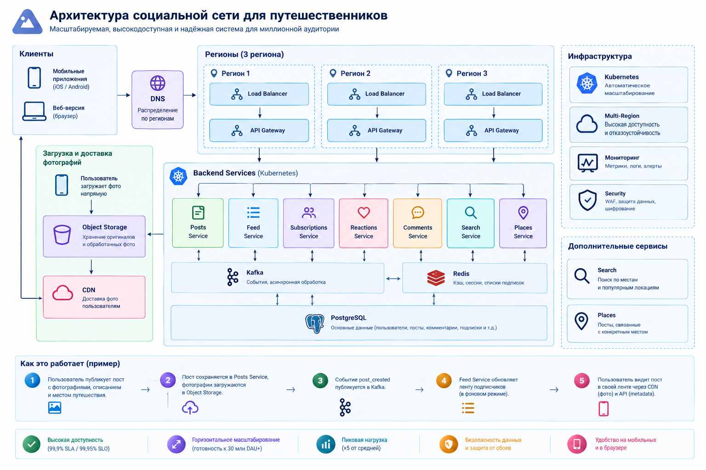
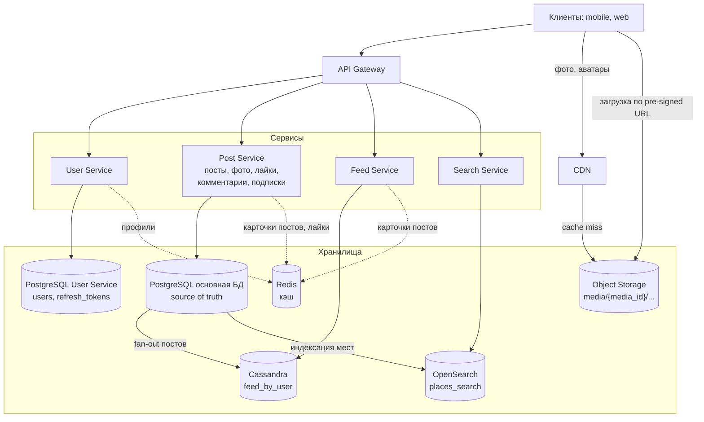
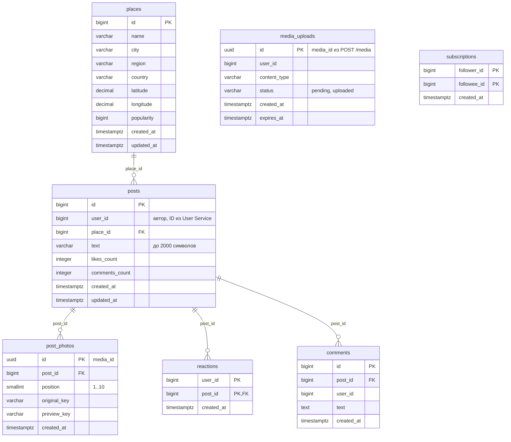
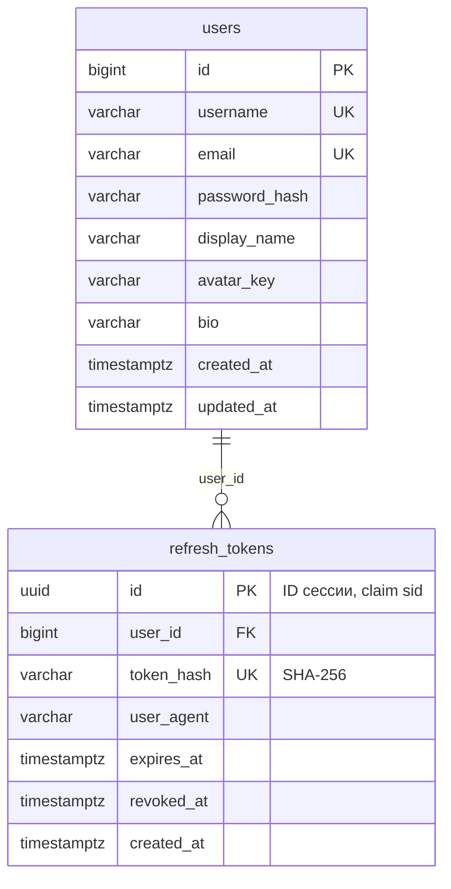
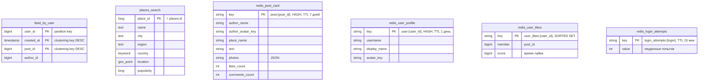

# Социальная сеть для путешественников

Домашняя работа для [курса Владимира Балуна по System Design](https://balun.courses/courses/system_design).

## Функциональные требования:

### Посты (Post)

Пользователь может публиковать посты из путешествий.

Пост содержит:

- фотографии (максимум - 10 штук)
- текстовое описание (максимум - 2000 символов)
- привязку к конкретному месту путешествия
- посты хранятся бессрочно

### Лайки (Reactions)

- Пользователь может оценивать посты других путешественников

### Комментарии (Comments)

- Пользователь может оставлять комментарии к постам
- Пользователь может открывать список комментариев к постам и читать их

### Подписки (Subscriptions)

- Пользователь может подписываться на других путешественников
- Пользователь может отписываться от других путешественников
- Число подписок и подписчиков не ограничено

### Лента (Feed)

- Пользователь может просматривать свою ленту, сформированную из публикаций пользователей, на которых он подписан
- Посты в ленте отображаются в обратном хронологическом порядке
- Пользователь может просматривать посты другого путешественника
- Пользователь может просматривать свои посты

### Поиск (Search)

- Пользователь может пользоваться поиском популярных мест для путешествий: ввести название региона или города и получить список из 10 мест, популярных у путешественников в этой области

### Места (Places)

- Пользователь может выбрать одно из найденных мест и просмотреть посты, связанные с этим местом.

### Клиенты

Система должна быть доступна через мобильные устройства и браузер

## Нефункциональные требования:

### Аудитория приложения

- Система должна поддерживать не менее 10 млн DAU

- Peak Concurrent Users (PCU) — 1 млн пользователей 

- Предполагается, что в часы максимальной активности одновременно используют приложение около 10% DAU

- В среднем один активный пользователь поддерживает 2 открытых соединения

### Поведение пользователей

- Пользователь в среднем создаёт 0,1 поста в сутки

- Пользователь открывает ленту 20 раз в сутки

- Пользователь ставит 5 реакций в сутки

- Пользователь создаёт 0,5 комментария в сутки

- Пользователь открывает комментарии 5 раз в сутки

- Пользователь выполняет 2 поиска мест в сутки

- Пользователь открывает страницу популярного места 1 раз в сутки

- Пользователь в среднем создаёт 0,2 подписки и 0,2 отписки в сутки

### Сезонность

Ожидается повышение пользовательской активности в периоды сезонного спроса на путешествия:

- 31 декабря – 8 января — новогодние праздники

- 1–11 мая — майские праздники

- 1 июня – 31 августа — летний отпускной сезон

Для расчета пиковой нагрузки используется коэффициент ×5 относительно среднего RPS. Коэффициент учитывает повышение пользовательской активности в часы максимальной нагрузки и в периоды сезонного спроса.

### Лимиты и ограничения

- Один пост содержит не более 10 фотографий

- Длина текста поста — не более 2000 символов

- Одна страница ленты содержит 20 постов

- Одна выдача комментариев содержит 20 комментариев

- Поиск возвращает до 10 популярных мест

### Временные ограничения

Производительность измеряется по p95:

- Лайки (Reactions) — ≤ 1 с

- Поиск (Search) — ≤ 2 с

- Комментарии (Comments) — ≤ 1 с

- Посты (Posts) — ≤ 1 с

- Лента (Feed) — ≤ 1 с

- Места (Places) — ≤ 1 с

### Масштабируемость

- Система должна поддерживать не менее 10 млн DAU

- Архитектура должна позволять горизонтально масштабироваться без изменения бизнес-логики - за счет добавления дополнительных экземпляров приложения

- В часы максимальной активности система должна поддерживать около 1 млн одновременно активных пользователей

- При двух открытых соединениях на одного пользователя система должна поддерживать около 2 млн одновременных соединений

- С запасом система должна поддерживать до 3 млн одновременных соединений

### Доступность

**SLO:** 99,95% доступности в месяц

## Архитектура нашей системы

    
## Исходные данные от бизнеса и аналитиков

### Данные о постах

- пользователь создает в среднем 0,1 поста в сутки (то есть в целом 1 млн постов от пользователей в сутки);
- один пост содержит в среднем 3 фотографии;
- средний размер исходной фотографии — 2 МБ;
- сжатая фотография для просмотра в ленте — 200 КБ;
- размер метаданных одного поста в API — 5 КБ

### Данные о ленте

- пользователь открывает ленту 20 раз в сутки;
- одна страница ленты содержит 20 постов;
- 70% фотографий в ленте загружаются благодаря lazy loading;

### Данные о лайках

- пользователь ставит 5 реакций в сутки;
- один запрос/ответ для операции с реакцией — 1,5 КБ

### Данные о комментариях

- пользователь создает 0,5 комментария в сутки (1 комментарий раз в два дня);
- пользователь открывает комментарии к постам 5 раз в сутки;
- одна выдача комментариев содержит 20 комментариев;
- размер одного комментария в API — 1 КБ;

### Данные о поиске

- пользователь выполняет 2 поиска мест в сутки;
- размер результата поиска — 5,5 КБ (изначально у нас выпадает только список названий мест - без постов пользователей и фотографий)
- пользователь кликает на место из поиска 1 раз в сутки;
- после клика пользователь получает выдачу из 20 постов из популярного места

### Данные о подписках

- среднее количество подписок пользователя — 100

## Предварительные расчеты трафика и RPS для всех подсистем нашего приложения

Примечание: Peak RPS рассчитываем как Average RPS × 5. Коэффициент 5 выбран как запас для пиковых периодов нагрузки.

### Посты (Posts)

В сутки создается 1 000 000 постов.

- Average Write RPS: 1 000 000 постов в сутки / 86 400 секунд ≈ 12 RPS

- Peak Write RPS: 12 RPS × 5 ≈ 60 RPS

Размер метаданных одного поста — 5 КБ.

- API-трафик: 1 000 000 × 5 КБ / 86 400 ≈ 58 КБ/с.

Peak API-трафик: 58 × 5 ≈ 290 КБ/с.

### Подписки (Subscriptions)

Один пользователь делает в среднем 0,2 новых подписки и 0,2 отписки в сутки.

10 000 000 пользователей × 0,2 подписки = 2 000 000 подписок/сутки

10 000 000 пользователей × 0,2 отписки = 2 000 000 отписок/сутки

Всего: 4 000 000 операций/сутки

- **Average RPS**: 4 000 000 / 86 400  ≈ 46 RPS

- **Peak RPS**: 46 × 5 ≈ 230 RPS

Для расчета трафика предполагаем, что один запрос на подписку/отписку — это ~500 байт, а ответ сервиса — тоже ~500 байт.

Итого один запрос/ответ — около 1 КБ.

- **Average API-трафик**: 4 000 000 × 1 КБ / 86 400 ≈ 46 КБ/с.

- **Peak API-трафик**: 46 × 5 ≈ 231 КБ/с.

### Лента (Feed)

#### Чтение персональной ленты пользователя, которая формируется из постов тех людей, на которых он подписан

10 000 000 пользователей × 20 запросов ленты в сутки = 200 000 000 запросов/сутки

- **Average Read RPS**: 200 000 000 запросов ленты / 86 400  ≈ 2 315 RPS

- **Peak Read RPS**: 2 315 RPS × 5 ≈ 11 575 RPS

Одна страница ленты содержит 20 постов. Размер метаданных одного поста — 5 КБ.

- **Average API-трафик**: 200 000 000 × 100 КБ / 86 400 ≈ 231 МБ/с.

- **Peak API-трафик**: 231 × 5 ≈ 1,16 ГБ/с.

#### Обновление ленты всех подписчиков при создании нового поста

В среднем у пользователя 100 подписчиков.

Один новый пост приводит к 1 × 100 = 100 обновлениям лент подписчиков.

Количество обновлений в сутки: 1 000 000 × 100 = 100 000 000 обновлений.

- **Обновления materialized feed - Average Write RPS**: 100 000 000 / 86 400 ≈ 1 157 RPS

- **Обновления materialized feed - Peak Write RPS**: 1 157 × 5  ≈ 5 785 RPS

Основной внешний API-трафик ленты формируется запросами на чтение.

- **Average API-трафик**: 231 МБ/с.

- **Peak API-трафик**: 1,16 ГБ/с.

#### Суммарная нагрузка Ленты:

Суммарный RPS включает чтение пользовательской ленты и внутренние обновления materialized feed подписчиков.

- **Average RPS**: 2 315 + 1 157 ≈ 3 472 RPS
- **Peak RPS**: 11 575 + 5 785 ≈ 17 360 RPS

При этом внешний API-трафик формируется преимущественно запросами на чтение ленты, поскольку обновления materialized feed являются внутренними операциями.

- **Average API-трафик**: ≈ 231 МБ/с
- **Peak API-трафик**: ≈ 1,16 ГБ/с

### Лайки (Reactions)

В среднем пользователь ставит 5 лайков в сутки.

Среднее количество реакций: 10 000 000 пользователей × 5 лайков = 50 000 000 реакций/сутки

**Average Write RPS**: 50 000 000 реакций / 86 400 ≈ 580 RPS

**Peak Write RPS**: 580 × 5 ≈ 2 900 RPS

Средний размер запроса/ответа - 1,5 КБ

**Average traffic**: 50 000 000 × 1,5 КБ / 86 400 ≈ 0,87 МБ/с

**Peak traffic**: 0,87 × 5 ≈ 4,34 МБ/с

### Комментарии (Comments)

#### Написание комментария

Пользователь пишет в среднем 0,5 комментария в сутки (1 комментарий раз в два дня)

10 000 000 × 0,5 = 5 000 000 комментариев/сутки

**Average Write RPS**: 5 000 000 / 86 400 ≈ 58 RPS

**Peak Write RPS**: 58 × 5 ≈ 290 RPS

**Average traffic** ≈ 5 000 000 × 1 КБ / 86 400 ≈ 58 КБ/с.

**Peak traffic** ≈ 58 × 5 ≈ 290 КБ/с.

#### Чтение комментариев под постом

Пользователь открывает комментарии пять раз в сутки.

10 000 000 пользователей × 5 = 50 000 000 запросов/сутки

**Average Read RPS**: 50 000 000 / 86 400 ≈ 580 RPS

**Peak Read RPS**: 580 × 5 ≈ 2 900 RPS

Одна выдача содержит 20 комментариев по 1 КБ. Размер одной выдачи: 20 × 1 КБ = 20 КБ.

**Average traffic:** ≈ 50 000 000 × 20 КБ / 86 400 ≈ 11,6 МБ/с

**Peak traffic** ≈ 11,6 × 5 ≈ 57,9 МБ/с

#### Общая статистика по комментариям

**Average RPS**: ≈ 638 RPS

**Peak RPS**: ≈ 3 190 RPS

**Average traffic**: 0,058 + 11,6 ≈ 11,7 МБ/с

**Peak traffic**: ≈ 11,7 × 5 ≈ 58,5 МБ/с

### Поиск (Search)

Пользователь дважды обращается к поиску в сутки.

10 000 000 × 2 = 20 000 000 запросов/сутки

**Average Read RPS**: 20 000 000 запросов / 86 400 ≈ 231 RPS

**Peak Read RPS**: 231 RPS × 5 ≈ 1 155 RPS

При размере ответа 5,5 КБ:

**Average traffic**: 20 000 000 × 5,5 КБ / 86 400 ≈ 1,27 МБ/с

**Peak traffic**: 1,27 × 5 ≈ 6,37 МБ/с

### Популярные места (Places)

Этот сервис позволяет пользователю просматривать посты, связанные с конкретным популярным местом.

Пользователь открывает одно популярное место из поиска в сутки.

10 000 000 пользователей * 1 запрос = 10 000 000 запросов/сутки

**Average Read RPS**: 10 000 000 / 86 400 ≈ 116 RPS

**Peak Read RPS**: 116 × 5 ≈ 580 RPS

Одна выдача содержит 20 постов. Размер метаданных одного поста — 5 КБ.

Размер одной выдачи: 20 × 5 КБ = 100 КБ.

**Average traffic**: 10 000 000 × 100 КБ / 86 400 ≈ 11,6 МБ/с

**Peak traffic**: 11,6 × 5 ≈ 57,9 МБ/с

### Сводная нагрузка

| Подсистема    | Average RPS | Peak RPS | Average API-трафик | Peak API-трафик |
| ------------- | ----------: | -------: | -----------------: | --------------: |
| Posts         |        ≈ 12 |     ≈ 60 |          ≈ 58 КБ/с |      ≈ 290 КБ/с |
| Subscriptions |        ≈ 46 |    ≈ 230 |          ≈ 46 КБ/с |      ≈ 231 КБ/с |
| Feed          |     ≈ 3 472 | ≈ 17 360 |         ≈ 231 МБ/с |     ≈ 1,16 ГБ/с |
| Reactions     |       ≈ 579 |  ≈ 2 895 |        ≈ 0,87 МБ/с |     ≈ 4,34 МБ/с |
| Comments      |       ≈ 637 |  ≈ 3 185 |        ≈ 11,7 МБ/с |     ≈ 58,5 МБ/с |
| Search        |       ≈ 231 |  ≈ 1 155 |        ≈ 1,27 МБ/с |     ≈ 6,37 МБ/с |
| Places        |       ≈ 116 |    ≈ 580 |        ≈ 11,6 МБ/с |     ≈ 57,9 МБ/с |

## Модель хранения данных

| Хранилище | Данные | Файл |
|---|---|---|
| PostgreSQL (основная БД) | posts, post_photos, media_uploads, reactions, comments, subscriptions, places | `database/postgresql.dbml` |
| PostgreSQL User Service | users, refresh_tokens | `database/user_service.dbml` |
| Cassandra / ScyllaDB | feed_by_user — материализованная лента | `database/cassandra.dbml` |
| OpenSearch | places_search — поиск мест | `database/opensearch.dbml` |
| Redis | кэш карточек постов, профилей, лайков, попыток входа | `database/redis.dbml` |
| Object Storage (S3) + CDN | оригиналы и preview фото, аватары | ключи `media/{media_id}/original.jpg`, `preview.jpg` |

PostgreSQL — источник истины. Cassandra, OpenSearch и Redis строятся из него и могут быть восстановлены. Пользователи вынесены в отдельный сервис со своей базой, поэтому `user_id` в основной БД хранится без внешнего ключа. Для Cassandra, OpenSearch и Redis DBML используется только для визуализации: реальная схема (CQL, mapping, ключи) — в комментариях в начале файлов.

### Схема хранилищ

Сплошные стрелки — запись и чтение источника данных, пунктирные — чтение и обновление кэша.

### Основная БД (PostgreSQL)

Индексы: `posts (user_id, created_at)`, `posts (place_id, created_at)`, `post_photos (post_id, position) unique`, `comments (post_id, created_at)`, `subscriptions (followee_id, follower_id)`, `media_uploads (expires_at)`.

### User Service (PostgreSQL)

### Cassandra, OpenSearch, Redis

Полное описание полей — в `.dbml`-файлах в папке `database`.

## Расчёт потребления дисков для хранения и обработки данных на 1 год

| Тип | Объём | Операций ввода-вывода | Пропускная способность |
|---|---|---|---|
| SSD | 6 ТБ | 10 000 | 500 МБ/с |
| HDD | 32 ТБ | 100 | 150 МБ/с |

- IOPS и throughput считаются по пиковой нагрузке (Average × 5).
- Одна логическая операция = одна операция ввода-вывода.
- Репликация и шардирование не учитываются.
- Карточки постов кэшируются в Redis, cache hit 95%: на диск PostgreSQL доходит 5% чтений постов.

### Основная БД (PostgreSQL)

#### Посты

Читаются при отдаче ленты и страниц мест: 20 постов на страницу.

Capacity = 1 000 000 постов/сутки × 5 КБ × 365 = 1 825 ГБ
Iops (peak) = (11 575 лента + 580 места) × 20 × 5% (промахи кэша) + 60 (запись) = 12 215
Traffic (peak) = 12 155 × 5 КБ = 61 МБ/с

| Тип | Disks for Capacity | Disks for IOPS | Disks for Throughput | MAX |
|---|---|---|---|---|
| SSD | 1 | 2 | 1 | 2 |
| HDD | 1 | 123 | 1 | 123 |

Ограничивающий фактор — IOPS. Без кэша было бы 243 100 IOPS и 25 SSD.

#### Фотографии (метаданные)

Capacity = 3 000 000 фото/сутки × 200 Б × 365 = 219 ГБ
Iops (peak) = 60 постов × 3 фото = 180
Traffic (peak) = 180 × 200 Б ≈ 0,04 МБ/с

| Тип | Disks for Capacity | Disks for IOPS | Disks for Throughput | MAX |
|---|---|---|---|---|
| SSD | 1 | 1 | 1 | 1 |
| HDD | 1 | 2 | 1 | 2 |

Читаются вместе с постом, отдельной нагрузки на чтение не дают.

#### Незавершённые загрузки (media_uploads)

Строка живёт от `POST /media` до прикрепления к посту, не дольше суток.

Capacity = 3 000 000 загрузок/сутки × 150 Б < 1 ГБ
Iops (peak) = 3 000 000 × 3 операции (вставка, смена статуса, удаление) / 86 400 × 5 = 520
Traffic (peak) ≈ 0,08 МБ/с

| Тип | Disks for Capacity | Disks for IOPS | Disks for Throughput | MAX |
|---|---|---|---|---|
| SSD | 1 | 1 | 1 | 1 |
| HDD | 1 | 6 | 1 | 6 |

#### Лайки

Запись — вставка в `reactions` и обновление `posts.likes_count`. Чтение — проверка `liked_by_me` для постов старше 7 дней, которых нет в кэше лайков Redis.

Capacity = 50 000 000 лайков/сутки × 100 Б × 365 = 1 825 ГБ
Iops (peak) = 2 900 × 2 (запись) + 11 575 × 5% (чтение) = 6 380
Traffic (peak) = 6 380 × 100 Б ≈ 0,6 МБ/с

| Тип | Disks for Capacity | Disks for IOPS | Disks for Throughput | MAX |
|---|---|---|---|---|
| SSD | 1 | 1 | 1 | 1 |
| HDD | 1 | 64 | 1 | 64 |

#### Комментарии

Capacity = 5 000 000 комментариев/сутки × 1 КБ × 365 = 1 825 ГБ
Iops (peak) = 290 × 2 (запись + `comments_count`) + 2 900 (чтение) = 3 480
Traffic (peak) = 2 900 × 20 КБ + 290 × 1 КБ ≈ 58 МБ/с

| Тип | Disks for Capacity | Disks for IOPS | Disks for Throughput | MAX |
|---|---|---|---|---|
| SSD | 1 | 1 | 1 | 1 |
| HDD | 1 | 35 | 1 | 35 |

#### Подписки

Число активных связей почти не растёт: 2 млн подписок и 2 млн отписок в сутки компенсируют друг друга. Подписчики читаются при рассылке нового поста по лентам.

Capacity = 10 000 000 × 100 подписок × 60 Б + 2 индекса ≈ 140 ГБ
Iops (peak) = 230 (подписки и отписки) + 60 (чтение подписчиков для fan-out) = 290
Traffic (peak) = 60 × 100 подписчиков × 60 Б + 230 × 60 Б ≈ 0,4 МБ/с

| Тип | Disks for Capacity | Disks for IOPS | Disks for Throughput | MAX |
|---|---|---|---|---|
| SSD | 1 | 1 | 1 | 1 |
| HDD | 1 | 3 | 1 | 3 |

#### Места

Справочник около 1 000 000 мест, записи почти нет. Поиск идёт в OpenSearch, а название места денормализовано в карточку поста в Redis, поэтому нагрузки на чтение из PostgreSQL практически нет.

Capacity = 1 000 000 × 1 КБ ≈ 1 ГБ
Iops ≈ 0

Достаточно места на общем диске основной БД.

#### Итого по основной БД

Все таблицы лежат в одном экземпляре PostgreSQL, поэтому объём и нагрузка суммируются.

| Таблица | Capacity (год) | IOPS (peak) | Throughput (peak) |
|---|---|---|---|
| Посты | 1 825 ГБ | 12 215 | 61 МБ/с |
| Фотографии | 219 ГБ | 180 | 0,04 МБ/с |
| Загрузки | < 1 ГБ | 520 | 0,08 МБ/с |
| Лайки | 1 825 ГБ | 6 380 | 0,6 МБ/с |
| Комментарии | 1 825 ГБ | 3 480 | 58 МБ/с |
| Подписки | 140 ГБ | 290 | 0,4 МБ/с |
| Места | 1 ГБ | ≈ 0 | ≈ 0 |
| **Всего** | **≈ 5,8 ТБ, с индексами и WAL (×1,5) ≈ 8,8 ТБ** | **23 065** | **≈ 120 МБ/с** |

| Тип | Disks for Capacity | Disks for IOPS | Disks for Throughput | MAX |
|---|---|---|---|---|
| SSD | 2 | 3 | 1 | 3 |
| HDD | 1 | 231 | 1 | 231 |

**Основная БД → 3 SSD.** Ограничивающий фактор — IOPS.

### User Service (PostgreSQL)

Профили читаются в основном из Redis, на диск попадают промахи кэша (5%). Access-токен проверяется по подписи без базы, refresh-токены обновляются раз в 15 минут у каждого из 1 млн одновременных пользователей.

Capacity = (10 000 000 × 1 КБ + 10 000 000 × 2 сессии × 200 Б) × 1,5 ≈ 21 ГБ
Iops (peak) = (12 155 + 58 000) × 5% (профили) + 1 000 000 / 900 × 2 (токены) ≈ 5 730
Traffic (peak) = 3 508 × 1 КБ + 2 222 × 200 Б ≈ 4 МБ/с

| Тип | Disks for Capacity | Disks for IOPS | Disks for Throughput | MAX |
|---|---|---|---|---|
| SSD | 1 | 1 | 1 | 1 |
| HDD | 1 | 58 | 1 | 58 |

**User Service → 1 SSD.**

### Лента (Cassandra / ScyllaDB)

Для каждого пользователя хранятся последние 1000 записей по 32 Б. Запись — рассылка поста 100 подписчикам, чтение — страница ленты из одной партиции.

Capacity = 10 000 000 × 1 000 × 32 Б × 2 (накладные расходы, compaction) ≈ 640 ГБ
Iops (peak) = 5 785 (запись) + 11 575 (чтение) = 17 360
Traffic (peak) = 5 785 × 32 Б + 11 575 × 20 × 32 Б ≈ 7,6 МБ/с

| Тип | Disks for Capacity | Disks for IOPS | Disks for Throughput | MAX |
|---|---|---|---|---|
| SSD | 1 | 2 | 1 | 2 |
| HDD | 1 | 174 | 1 | 174 |

**Лента → 2 SSD.** Ограничивающий фактор — IOPS.

### Поиск мест (OpenSearch)

Capacity = 1 000 000 мест × 1 КБ × 2 (индекс) ≈ 2 ГБ
Iops (peak) = 1 155
Traffic (peak) = 1 155 × 5,5 КБ ≈ 6,4 МБ/с

| Тип | Disks for Capacity | Disks for IOPS | Disks for Throughput | MAX |
|---|---|---|---|---|
| SSD | 1 | 1 | 1 | 1 |
| HDD | 1 | 12 | 1 | 12 |

**Поиск → 1 SSD.**

### Фото (файлы в Object Storage)

На каждое фото сохраняются оригинал (2 МБ) и preview (200 КБ), 3 фото на пост. Аватар — 200 КБ + preview 20 КБ. Чтение идёт через CDN, на диски хранилища попадают только промахи CDN, поэтому хранилище считается по записи и объёму.

Capacity = 3 000 000 × (2 МБ + 200 КБ) × 365 + 10 000 000 × 220 КБ ≈ 2 411 ТБ
Iops (peak) = 6 000 000 объектов/сутки / 86 400 × 5 ≈ 347
Traffic (peak) = 6,6 ТБ/сутки / 86 400 × 5 ≈ 382 МБ/с

| Тип | Disks for Capacity | Disks for IOPS | Disks for Throughput | MAX |
|---|---|---|---|---|
| SSD | 402 | 1 | 1 | 402 |
| HDD | 76 | 4 | 3 | 76 |

**Фото → 76 HDD.** Ограничивающий фактор — объём, поэтому выгоднее HDD.

### Кэш (Redis)

Данные в оперативной памяти, диски не нужны.

RAM = 53 ГБ (карточки постов за 7 дней) + 3 ГБ (профили) + 22 ГБ (лайки за 7 дней) ≈ 78 ГБ
Ops (peak) ≈ 331 000/с, один экземпляр — около 100 000/с → 4 экземпляра

### Итого

| Хранилище | Capacity (год) | IOPS (peak) | Throughput (peak) | Диски |
|---|---|---|---|---|
| PostgreSQL (основная БД) | 8,8 ТБ | 23 065 | 120 МБ/с | 3 SSD |
| PostgreSQL (User Service) | 21 ГБ | 5 730 | 4 МБ/с | 1 SSD |
| Cassandra | 640 ГБ | 17 360 | 7,6 МБ/с | 2 SSD |
| OpenSearch | 2 ГБ | 1 155 | 6,4 МБ/с | 1 SSD |
| Object Storage | 2 411 ТБ | 347 | 382 МБ/с | 76 HDD |
| **Всего** | | | | **7 SSD + 76 HDD** |

Плюс Redis: ≈ 78 ГБ RAM, 4 экземпляра.

